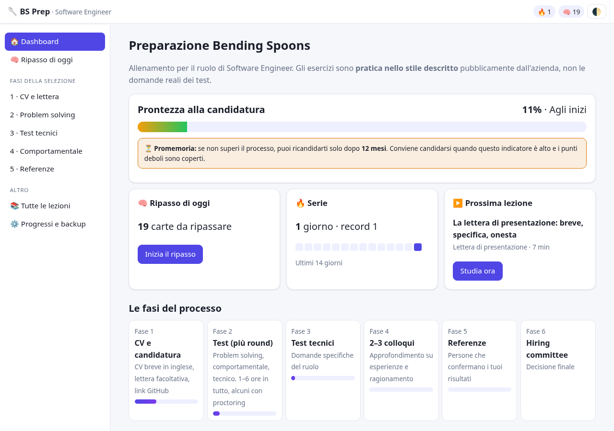
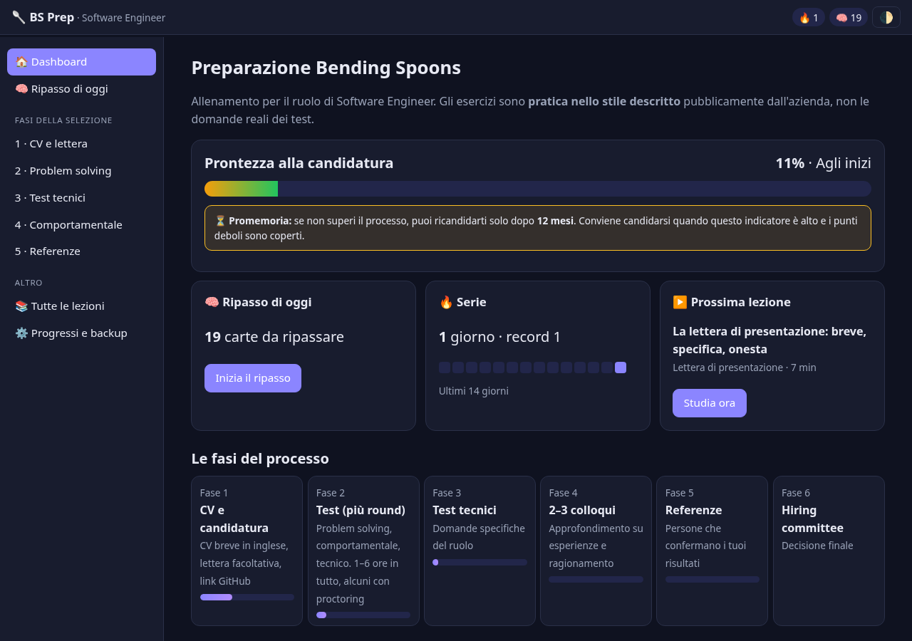
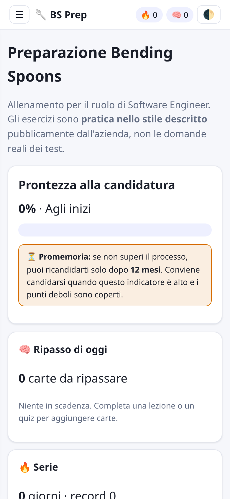

# BS Prep


BS Prep is a dependency-free, offline-first web application for preparing for a **Software Engineer** selection process. It combines structured study content, spaced repetition, quizzes, technical English practice, and optional encrypted-at-rest-free GitHub Gist synchronization.

The application is built with vanilla JavaScript, HTML, and CSS. It runs entirely in the browser, with no runtime framework and no required backend for core study features.





## What it does

- Provides practice material for problem solving, technical fundamentals, system design, coding, behavioral interviews, and references.
- Includes a technical English section covering software engineering vocabulary, system design, data terminology, false friends, Slack/email writing, design documents, pull requests, and STAR responses.
- Tracks lesson completion, quiz scores, daily activity, and SM-2 spaced-repetition cards in `localStorage`.
- Generates a daily review queue from due spaced-repetition cards.
- Supports optional GitHub login and synchronization through a user-owned secret Gist.
- Works as an installable PWA with offline-friendly static assets.

The project does not contain real Bending Spoons interview questions. It is an independent preparation tool inspired by publicly described interview areas.

## Technical highlights

| Area | Implementation |
|---|---|
| Frontend | Vanilla JavaScript, HTML, CSS, Web Components-free modular scripts |
| State | Browser `localStorage` with stable, versioned identifiers |
| Spaced repetition | SM-2 scheduling for lesson and quiz cards |
| Synchronization | GitHub Gist backup with timestamp-based merge logic |
| OAuth | Cloudflare Worker exchanges a GitHub OAuth code for a scoped access token |
| Security | Strict HTML allowlist sanitizer, CSP, OAuth state validation, security regression tests |
| CI/CD | GitHub Actions for Pages deployment, security tests, CodeQL, and content updates |
| Dependencies | No runtime npm dependencies for the main application |

## Architecture

```text
Browser app
├── Static HTML/CSS/JavaScript
├── Local progress store (localStorage)
├── HTML allowlist sanitizer
├── SM-2 review scheduler
└── Optional GitHub Gist sync
        │
        └── Cloudflare Worker
            ├── OAuth state issuance and verification
            ├── GitHub code-to-token exchange
            ├── CORS origin allowlist
            └── Scope validation (gist only)
```

The browser communicates directly with `api.github.com` after OAuth. The Worker never stores or logs the GitHub access token; it only performs the short-lived code-for-token exchange and returns the token to the user’s browser.

## Security model

- Lesson HTML is sanitized with a strict tag and class allowlist before rendering.
- A Content Security Policy restricts scripts, connections, frames, object embedding, and base URI usage.
- OAuth state values are HMAC-signed, time-limited, and verified with constant-time digest comparison.
- The Worker validates the OAuth redirect URI against an explicit origin allowlist.
- The GitHub token is requested with the narrow `gist` scope only.
- Security regression tests cover XSS-style payloads, event handlers, dangerous URLs, mutation-XSS-like input, OAuth state tampering, invalid redirects, oversized requests, and unexpected OAuth scopes.
- CodeQL and Dependabot provide continuous static analysis and dependency update automation.

For responsible disclosure, see [SECURITY.md](SECURITY.md).

## Run locally

No build step is required.

```bash
git clone https://github.com/NicoGenti/bs-prep.git
cd bs-prep
python3 -m http.server 8000
```

Open <http://127.0.0.1:8000>.

The core application works without network access. External documentation links open only when selected.

## Run tests

```bash
npm test
```

The repository also includes focused scripts for content-update, synchronization merge, and Worker behavior:

```bash
node scripts/test-update.mjs
node scripts/test-sync-merge.mjs
node scripts/test-worker.mjs
```

## Deployment

### GitHub Pages

The site is deployed through [`.github/workflows/pages.yml`](.github/workflows/pages.yml) on every push to `main`. It can also be run manually from **Actions → Deploy GitHub Pages → Run workflow**.

### Cloudflare Worker

The OAuth helper is deployed through [`.github/workflows/deploy-worker.yml`](.github/workflows/deploy-worker.yml) when files under `worker/` change.

Required repository secrets:

- `CLOUDFLARE_API_TOKEN`
- `CLOUDFLARE_ACCOUNT_ID`

Required Worker secret:

- `GITHUB_CLIENT_SECRET`

The GitHub OAuth client ID is public and is configured in `sync-config.js` and `worker/wrangler.toml`.

## Content updates

A monthly workflow can propose new or refreshed study content through a pull request. The update script validates the generated JSON schema, sanitizes lesson HTML, rejects duplicate or unstable identifiers, checks generated JavaScript syntax, and avoids committing when validation fails.

The workflow requires an OpenAI-compatible chat-completions API key stored as the `LLM_API_KEY` repository secret. It never pushes directly to `main`; proposed changes require manual review and merge.

## Project structure

```text
.
├── index.html                  # Application shell and PWA entry point
├── app.js                      # Application bootstrap and routing
├── views-*.js                  # UI views and section rendering
├── generators.js               # Practice content generators
├── html-sanitize.js            # Strict HTML sanitizer
├── sync.js / sync-merge.js     # GitHub Gist synchronization and merge logic
├── data-*.js                   # Static study content
├── worker/                     # Cloudflare Worker for GitHub OAuth
├── scripts/                    # Content update and local test scripts
├── tests/                      # Security and integration regression tests
└── .github/workflows/          # CI/CD, Pages, CodeQL, and automation
```

## License

All rights reserved. See the repository for current licensing information.
