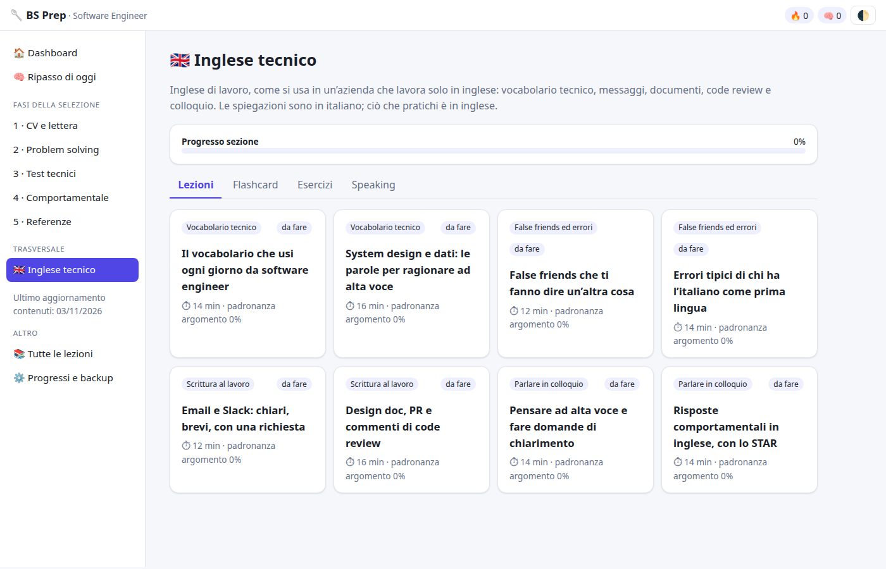

# BS Prep

Sito statico, in italiano, per preparare la selezione **Software Engineer** di Bending Spoons. È pratica nello stile descritto pubblicamente dall’azienda (problem solving, fondamenti, system design, coding, colloquio comportamentale, referenze): non contiene le domande reali dei test.

C’è anche una sezione **Inglese tecnico**: vocabolario di software engineering, system design e dati, false friends e errori tipici di chi parla italiano, messaggi Slack/email, design doc, PR e code review, ragionamento ad alta voce e risposte STAR. Le spiegazioni sono in italiano, il materiale da praticare è in inglese. Nella scheda Speaking si può ascoltare domanda e risposta con la sintesi vocale del browser (Web Speech API): se non c’è, il sito resta usabile e non fa richieste di rete.

I progressi restano nel browser (`localStorage`, chiave `bsprep.v1`): lezioni, punteggi e ripasso spaziato SM-2. Le carte usano id stabili (`L:lezione:indice`, `Q:argomento:indice`, `EX:enx-…`, `SP:ens-…`). Per questo gli aggiornamenti automatici non cancellano né riusano gli id esistenti.




## Uso in locale

Non c’è build. Dalla radice del repository:

```bash
python3 -m http.server 8000
```

Apri [http://127.0.0.1:8000](http://127.0.0.1:8000). Funziona anche aprendo `index.html` direttamente: script, stili e dati sono file locali, e il sito non chiama rete da solo. I link a documenti esterni (processo di selezione, LeetCode, NeetCode) si aprono solo se li clicchi.

Dalla home si vedono la prontezza, il ripasso del giorno e le sezioni, compresa Inglese tecnico. «Ultimo aggiornamento contenuti» è la data dell’ultimo giro dello script mensile (all’inizio, la data del materiale iniziale).

Per rifare i test locali:

```bash
node scripts/test-update.mjs
node scripts/test-sync-merge.mjs
node scripts/test-worker.mjs
```

Senza `clientId` e `workerUrl` in `sync-config.js` il pulsante «Accedi» non c’è: il sito resta solo offline, come prima.

## GitHub Pages

Il workflow [`.github/workflows/pages.yml`](.github/workflows/pages.yml) pubblica il sito con le action ufficiali `configure-pages`, `upload-pages-artifact` e `deploy-pages`. Parte a ogni push su `main` e si può lanciare a mano (Actions → **Deploy GitHub Pages** → Run workflow).

### Cosa configurare (una volta)

1. **Secret del modello.** Settings → Secrets and variables → Actions → New repository secret.
   - Nome: `LLM_API_KEY`
   - Valore: la chiave di un’API chat completions compatibile con OpenAI.
2. **Variabili opzionali** (Settings → Secrets and variables → Actions → Variables, non Secrets):
   - `LLM_BASE_URL` — default `https://api.openai.com/v1` (senza barra finale; lo script accetta anche la barra).
   - `LLM_MODEL` — default `gpt-4o-mini`.
3. **Pages.** Settings → Pages → Build and deployment → Source: **GitHub Actions**. Salva. Poi, se il primo deploy è fallito perché Pages non era ancora attivo, rilancia **Deploy GitHub Pages**.

Il sito pubblicato è l’insieme di `index.html`, CSS, JS e dati. Workflow, script e screenshot in `docs/` non vengono caricati.

### Repository privato

GitHub Pages su un repository **privato** richiede **GitHub Pro** o **GitHub Team** (oppure il repository va reso pubblico). Anche con Pro/Team, il sito Pages di un repository privato **è raggiungibile da chiunque abbia l’URL**: l’accesso al codice resta privato, la pagina no.

## Aggiornamento mensile dei contenuti

[`.github/workflows/monthly-update.yml`](.github/workflows/monthly-update.yml) gira il 1° di ogni mese alle 08:00 UTC e si può lanciare a mano: Actions → **Aggiornamento contenuti mensile** → Run workflow.

Lo script [`scripts/update-content.mjs`](scripts/update-content.mjs) (Node, senza dipendenze) chiede al modello di aggiornare nozioni superate e di aggiungere lezioni, carte, quiz, esercizi di inglese e domande di speaking su tecnologie e pratiche di colloquio utili per questa selezione. Poi:

- controlla lo schema JSON;
- rifiuta id già usati, rimozioni, indici fuori posto, HTML pericoloso e crescite assurde;
- esegue `node --check` sui file generati e li ricarica;
- se un controllo fallisce, **non scrive nulla** e il workflow si ferma senza commit;
- se `LLM_API_KEY` manca, scrive un messaggio chiaro ed esce senza errore (nessun commit);
- se c’è materiale nuovo, aggiorna la data «Ultimo aggiornamento contenuti» e il workflow fa commit su `main` con messaggio `chore: aggiornamento contenuti YYYY-MM-DD`.

Un commit fatto con `GITHUB_TOKEN` non rilancia gli altri workflow. Per questo, se il commit c’è, lo stesso workflow chiama il deploy di Pages (`workflow_call`).

Gli id già in uso non si toccano: si aggiungono id nuovi (il modello è istruito a prefissarli con `auto-` e la data) oppure si corregge solo il testo, carte e domande restano allo stesso indice.

## Accesso GitHub (opzionale)

Chiunque abbia un account GitHub può salvare i progressi in un **Gist segreto del proprio account**. Senza accesso il sito funziona tutto in locale, esattamente come prima: lezioni, quiz, ripasso SM-2 ed export/import JSON non dipendono dal login.

Il sito è statico, quindi non può custodire il client secret. Lo scambio `code` → token lo fa un Cloudflare Worker in [`worker/`](worker/). Chiede solo lo scope `gist`, controlla `state` (firmato, a scadenza, senza memorizzarlo) e l’origine CORS. Non scrive log e non tiene il token: lo rimanda al browser, che da lì parla solo con `api.github.com`.

Il token resta in `localStorage` (`bsprep.oauth`), separato dai progressi. In impostazioni è spiegato: serve solo a leggere e scrivere i Gist, ed «Esci» lo cancella. All’accesso il sito cerca o crea `bs-prep-progress.json`, scarica i dati, li unisce a quelli locali (per ogni voce vince il timestamp più recente; una carta SM-2 presente su un solo lato non si perde) e poi riscrive il Gist. I salvataggi partono qualche secondo dopo una modifica, quando la scheda va in secondo piano, e da «Sincronizza ora». Se la rete manca, i progressi restano sul dispositivo e il tentativo si ripete.

Un Gist segreto **non è privato**: non è in elenco sul profilo, ma chi ha il link può leggerlo.

### Configurazione

1. **OAuth App** su GitHub: Settings → Developer settings → OAuth Apps → New OAuth App.
   - Homepage URL: l’URL di GitHub Pages, con lo slash finale. Esempio: `https://<utente>.github.io/bs-prep/`
   - Authorization callback URL: **lo stesso URL**.
   - Registra l’app e genera un client secret. Il client id è pubblico; il secret no.
2. **Cloudflare** (piano gratuito): crea un account e un API token con il permesso di modificare i Workers (template «Edit Cloudflare Workers»). Copia anche l’Account ID.
3. **Secret del repository** (Settings → Secrets and variables → Actions), usati solo dal workflow di deploy:
   - `CLOUDFLARE_API_TOKEN`
   - `CLOUDFLARE_ACCOUNT_ID`
   Se mancano, [`.github/workflows/deploy-worker.yml`](.github/workflows/deploy-worker.yml) scrive un messaggio ed esce senza errore. Parte da solo quando cambia `worker/**`, oppure a mano da Actions → **Deploy Cloudflare Worker**.
4. In [`worker/wrangler.toml`](worker/wrangler.toml) imposta `ALLOWED_ORIGIN` con lo stesso URL della callback (lo slash finale è indifferente). È l’origine del sito: il worker rifiuta le altre. Poi fai il deploy (workflow, oppure in locale `npx wrangler deploy` dentro `worker/`).
5. **Segreti del worker**, mai nel frontend e mai nel toml:
   ```bash
   cd worker
   npx wrangler secret put GITHUB_CLIENT_ID
   npx wrangler secret put GITHUB_CLIENT_SECRET
   ```
6. In [`sync-config.js`](sync-config.js) scrivi il client id e l’URL del worker (`https://bs-prep-oauth.<account>.workers.dev`, senza path). Fai commit: Pages ripubblica il sito e compare «Accedi».

La Content-Security-Policy consente script solo dal sito, e le connessioni verso `api.github.com` e `https://*.workers.dev`. Un dominio custom del worker va aggiunto a `connect-src` in `index.html`.
